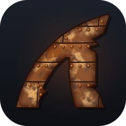
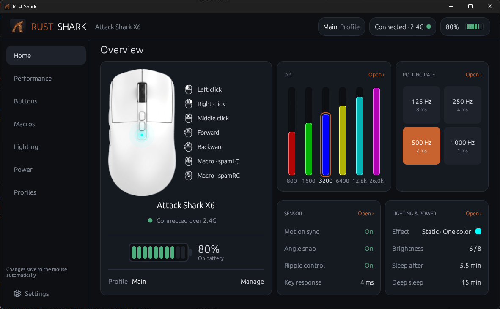
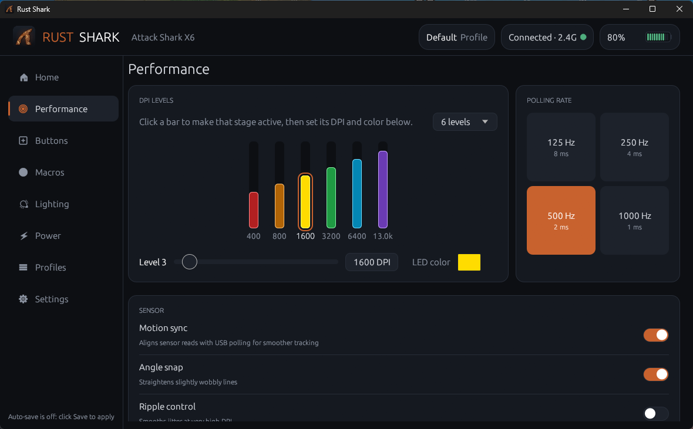
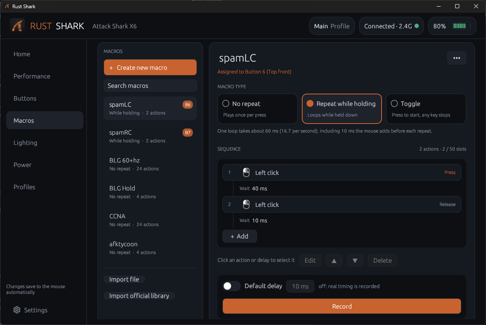
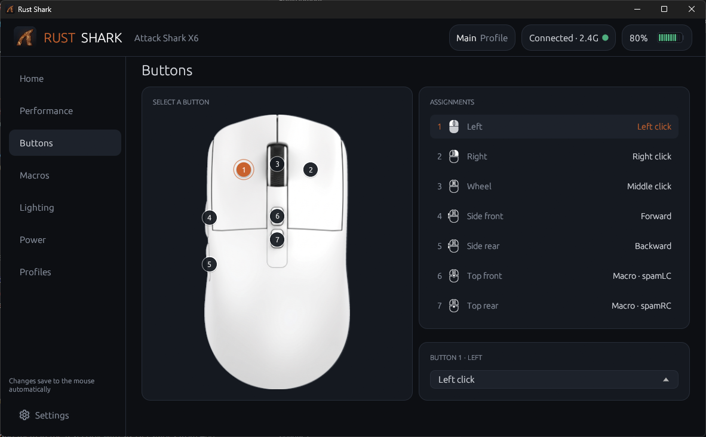
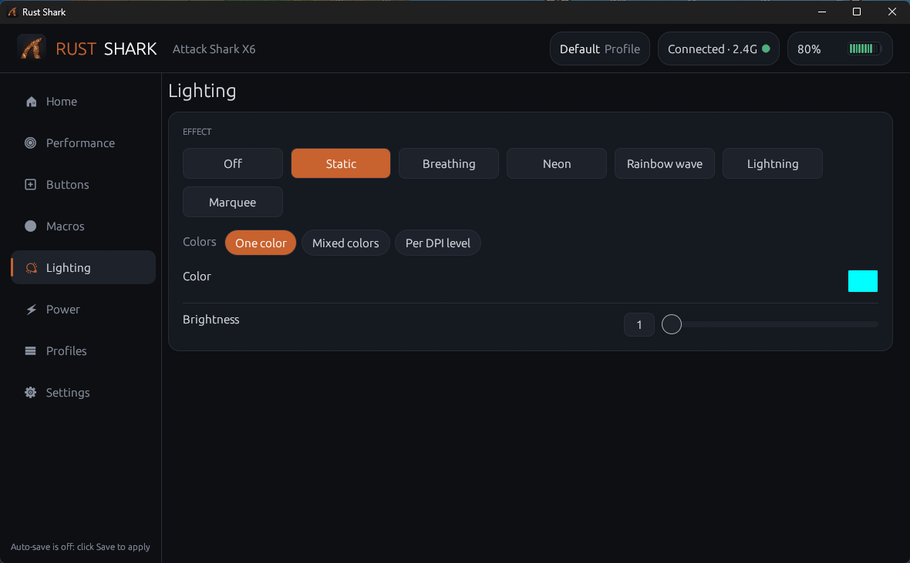

<p align="center"></p>

# Rust Shark

**A cleaner, faster and better-looking alternative to the official Attack Shark X6 software.**

Rust Shark is a native control app for the **Attack Shark X6** wireless mouse, written in Rust.
It does everything the official app does, in one small `.exe`: no installer, no background
service, and it starts instantly.

<p align="center"></p>

| Performance | Macros |
| --- | --- |
|  |  |
| **Buttons** | **Lighting** |
|  |  |

> Not affiliated with or endorsed by Attack Shark. "Attack Shark" is their trademark.

## Features

- **DPI**: 6 stages, value and LED color per stage, live sync when you switch DPI on the mouse
- **Polling rate**: 125 / 250 / 500 / 1000 Hz
- **Buttons**: remap all 7 buttons to mouse functions, DPI, media, keyboard shortcuts or macros
- **Macros**: record or build sequences, edit and reorder actions and delays, repeat modes,
  import/export as JSON
- **Lighting**: effects, color, brightness and speed
- **Power**: sleep and deep-sleep timers, battery level
- **Sensor**: key response time, ripple control, angle snap, motion sync
- **Profiles**: multiple profiles, imported from the official app on first run
- **Auto-save** or an explicit Save / Reset bar; every write is confirmed by the mouse and
  retried if it's missed (e.g. while the mouse sleeps)
- **DPI indicator**: blink, static or off when you change DPI (a firmware option the
  official app doesn't expose)
- **System tray**: close to tray, start with Windows, start minimized

### Known limits

- **Battery** is reported by the mouse firmware in 10% steps. On some units (seen on an X6
  with device ID `0x10`) it reports 100% whenever the mouse runs on battery, and only gives a
  real level while charging; no app can fix that.
- **Lift-off distance** (0.7 / 1 / 2 mm) is written to the firmware's own lift-off field, but a
  paper-stack test showed no change in tracking cutoff on the X6. The official app's switch
  never reaches the mouse at all. [Details](docs/lift-off-distance.md).
- Windows only (it talks to the mouse through the Windows HID API).

## Download / build

Grab `RustShark.exe` from the [latest release](https://github.com/Abosmra/rust-shark/releases/latest),
or build it yourself. Building requires [Rust](https://rustup.rs/) (stable) on Windows.

```bash
git clone https://github.com/Abosmra/rust-shark
cd rust-shark
cargo build --release
```

The app is `target/release/rust-shark.exe`. Close the official Attack Shark app first:
both can't talk to the receiver at the same time.

Settings are stored in `%APPDATA%\RustShark\config.json`.

```bash
cargo test
```

### Releasing

CI builds and tests every push. To publish a release, bump `version` in `Cargo.toml`, then
push a tag; the workflow attaches the built `.exe`:

```bash
git tag v0.2.0
```

```bash
git push origin v0.2.0
```

## Project layout

| Path | What it does |
| --- | --- |
| `src/protocol.rs` | Settings model and the packet builders for the X6 (no I/O, unit-tested) |
| `src/device.rs` | HID connection, background writer thread, status reports (battery, DPI changes) |
| `src/store.rs` | Config file, import from the official app's `pro.data` / `macro.data` |
| `src/keys.rs` | Button functions, key codes and names |
| `src/ui.rs` | The egui interface |
| `tools/` | Scripts that generate the logo and the embedded icon data |
| `tools/capture-shim/` | Logging stand-in for the official app's HID driver, to capture what it sends |

`protocol.rs` has no dependencies on the UI, so it's the place to start if you want to
support the X6 from another app or language.

## Protocol notes

Reverse-engineered from the official app and USB captures, and cross-checked against the
[Attack Shark X11 driver docs](https://github.com/HarukaYamamoto0/attack-shark-x11-driver/tree/main/docs),
which describe the same firmware family in much more detail. Useful if you're writing your own tool.

> [!CAUTION]
> Never send or read report `0x10`. On this firmware family it puts the mouse into its
> bootloader (firmware-update mode). Rust Shark never uses it.

- **USB IDs**: VID `0x1D57`, PID `0xFA60` (2.4 GHz receiver), `0xFA61` (wired).
- **Writes** are HID feature reports on the interface with usage page `0x0B`, sent at their
  exact length. Packet: `[cmd][len][01][payload…][sum16 hi][sum16 lo]`, where the checksum
  is the sum of bytes from index 3. The `01` is the profile number.
- **Status** comes as 5-byte input reports on usage page `0x0A`: `03 <device> <event> <p1> <p2>`.
  The X6 reports device ID `0x10`.

  | Event | Meaning |
  | --- | --- |
  | `40` | Battery: `p1` = state (1 on battery, 2 full, 3 charging), `p2` = level 0–10. Sent every ~2 s. |
  | `50` | Write result: `p1` = `00` accepted / `01` rejected, `p2` = the report it refers to. Arrives ~0.2 s after a write. |
  | `10` | DPI stage changed on the mouse: `p1` = new stage (1-based) |

- **Reading settings back** works with a one-time permission each read: send
  `a0 <report> <length> 00 <profile> 00 00 00`, read report `a0`, then read the target
  report. The reply has the write layout with a length byte 2 higher.
  ⚠️ On the X6's 2.4 GHz receiver, several reads in a row (or two programs reading at once)
  jammed the receiver and froze the mouse for about a minute, so Rust Shark doesn't read back.

| Cmd | Length | Contents |
| --- | --- | --- |
| `04` | 56 | DPI: per-stage value (`DPI / 50 − 1`), enabled mask, active stage, 8 RGB colors, angle snap, ripple, motion sync. Byte 3's high nibble is a lift-off field the X6 stores but [doesn't apply](docs/lift-off-distance.md). |
| `05` | 15 | Lighting mode, speed, brightness, color, sleep timers, key response |
| `06` | 9 | Polling: `1` = 1000 Hz, `2` = 500, `4` = 250, `8` = 125, plus its inverse |
| `08` | 59 | Button map: 18 slots × 3 bytes (function, shortcut `[0x11, mods, key]`, macro `[0x12, 0, slot+1]`) |
| `09` | 64 ×3 | Macro upload: 131-byte buffer in 3 chunks; event = delay byte (`ms/10`, press `0x01` / release `0x81`) + key code; max 50 events |
| `0b` | 8 | Firmware version (read only) |
| `0c` | 10 | Active profile and number of profiles (`01 fe 01 fe` = profile 1 of 1). Rust Shark sends it before a full write. |

> [!WARNING]
> The mouse can hold up to 5 profiles, but on the X6, switching to 2 profiles and back to 1
> reset profile 1 to factory defaults (macros survived, button assignments didn't).
> Test onboard profiles carefully before relying on them.

See `src/protocol.rs` and its tests for the exact byte layouts.

## Contributing

Issues and pull requests are welcome. If you have a different Attack Shark model, a USB
capture from the official app is the most useful thing you can share.

## Credits

- [HarukaYamamoto0's Attack Shark X11 driver](https://github.com/HarukaYamamoto0/attack-shark-x11-driver)
  for documenting the shared protocol: status events, the read handshake, profiles and the
  `0x10` warning all came from there.
- Keyboard and mouse input icons by [amanz](https://amanz.itch.io/keyboard-mouse-icon-pack-free) (CC0).
- Animated settings icon by [Icons8](https://icons8.com).
- Built with [egui](https://github.com/emilk/egui) and [hidapi](https://github.com/ruabmbua/hidapi-rs).

## License

[MIT](LICENSE). The input icons are CC0 (see `assets/input-icons/CREDITS.md`).
